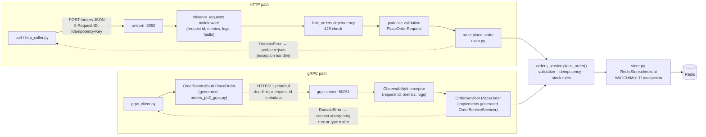

# Assignment 2 — HTTP APIs, gRPC and Metrics

Enterprise Software Development, Fall 2026 · Online Store (extends Assignment 1)

> Raw outputs quoted below are in `evidence/` (captured from the running
> Docker stack). Items marked **📸 Screenshot** still need to be captured and
> placed in `screenshots/a2/`.

## 0. What changed since A1, in one paragraph

A1 kept everything in a Python dict inside the FastAPI process. A second
process (the gRPC service) could not share that, so A2 moves the data to
**Redis** (the one source of truth) and the business rules to
**`app/orders_service.py`** (validation, stock checks, order state machine,
idempotency). The FastAPI routes (`app/main.py`) and the gRPC servicer
(`app/grpc_server.py`) are both thin adapters over that module. Neither
touches Redis directly, and neither calls the other.

```
app/
  orders_service.py   business rules (shared)      store.py      Redis access (shared)
  errors.py           domain errors -> HTTP + gRPC  models.py     pydantic models
  main.py             HTTP adapter (FastAPI)        grpc_server.py gRPC adapter
  ratelimit.py        429 limiter                   grpc_observability.py interceptor
  faults.py           demo fault switch             proto/orders.proto, gen/ (generated)
clients/  http_caller.py, reliability_demo.py, grpc_client.py
tests/    37 pytest tests                           openapi.yaml  the HTTP spec
```

---

## Part A — HTTP API

### A.1 REST constraints

| # | Constraint | Plain-language meaning | In this API |
|---|------------|------------------------|-------------|
| 1 | Client–server | The client (UI, other service) and the server are separate and only talk through the API, so each can change on its own. | `http_caller.py`, curl and the gRPC client only know the API; none of them knows Redis exists. The store moved from a dict to Redis without any caller noticing. |
| 2 | Stateless | Every request carries everything the server needs; the server keeps no per-client session between requests. | The cart is a resource named in the URL (`/carts/{cart_id}`), retries carry their own `Idempotency-Key`, so any instance could serve any request. One deliberate exception: the rate-limit counter lives in process memory, see A.4. |
| 3 | Cacheable | Responses say whether they can be cached and for how long, so clients and proxies can reuse them. | **Not demonstrated.** No `Cache-Control`/`ETag` headers are sent. `GET /products` would be a good candidate. |
| 4 | Uniform interface | Resources have URLs, are handled with the standard methods, messages describe themselves, and responses can link to related resources. | Nouns in paths (`/orders/{id}`), methods by meaning (GET read, PUT set, PATCH partial update, POST create, DELETE remove), typed `application/problem+json` errors, `Location` header pointing at the created order. Full hypermedia links (HATEOAS) are not implemented. |
| 5 | Layered system | A client can't tell whether it is talking to the real server or to something in between (proxy, gateway, cache). | Partly. Clients only see `:8050`; Redis sits behind the API, and a reverse proxy or gateway could be put in front without any client change. There is no proxy in this deployment. |
| 6 | Code on demand *(optional)* | The server can send code for the client to run. | Not used by the API itself. The only example is `/docs`, which sends Swagger UI's JavaScript to the browser. |

### A.2 OpenAPI Specification

**What it is.** OpenAPI is a standard, machine-readable (YAML/JSON) description
of an HTTP API: its paths, methods, parameters, request bodies, responses and
error formats. Because it is machine-readable, one document can drive
interactive documentation, generated client SDKs, mock servers and automated
contract tests, and it serves as the agreement between API providers and
consumers.

**This project's spec:** `openapi.yaml` (OpenAPI 3.1, generated from the
FastAPI route declarations by `python scripts/export_openapi.py`). Every route
declares its success model and its error responses, which share a single
`Problem` schema (`application/problem+json`). `POST /orders` documents
`201` (with `Location`, `Idempotent-Replayed` and `X-RateLimit-Remaining`
headers), `404`, `409`, `422`, `429` (with `Retry-After`) and `503`, plus the
`Idempotency-Key` header.

**How I used it**

1. **Contract test:** `tests/test_contract.py` loads `openapi.yaml` and sends
   `POST /orders` four ways (created, empty cart, invalid body, rate limited).
   Each time it checks that the status code is documented, the content type is
   documented, the body validates against the declared JSON Schema
   (`jsonschema`) and the documented headers are present.
2. **Drift test:** `tests/test_openapi.py` fails if `openapi.yaml` no longer
   matches the routes in the code.
3. **Inspect/try:** Swagger UI at `http://localhost:8050/docs` renders the
   spec. I used *Try it out* on `POST /orders`.
   **📸 Screenshot:** Swagger UI showing `POST /orders` with its documented
   responses, and the result of *Try it out*.

### A.3 Applying the practices — user task "Place an order"

| | Before (A1) | After (A2) |
|---|---|---|
| **Endpoint** | `POST /orders?cart_id=X` | `POST /orders` with body `{"cart_id": "X"}`, optional `Idempotency-Key` header |
| **Problem** | Input was in the query string and not validated (any string accepted). Empty cart and out-of-stock both returned the same `400`. Errors were `{"detail": "..."}`. No `Location`. A retry after a lost response returned a confusing `400` ("cart is empty"), and the client couldn't tell whether the order existed. Unlimited calls. | |
| **Change** | | Body validated by pydantic (`cart_id` 1–64 chars `[A-Za-z0-9_-]`, unknown fields rejected) → `422`. Business failures → `409` with a distinct problem `type` (`cart-empty`, `insufficient-stock`). Every error is RFC 9457 problem details. `201 Created` + `Location: /orders/{id}`. Idempotency key → a repeat returns the original order with `Idempotent-Replayed: true`. Rate limited (5 per 10 s per client IP). Stock check and deduction are atomic (Redis `WATCH`/`MULTI`). |
| **Reason** | | A creating action with a body belongs in the body. `422` means "your request is malformed" and `409` means "valid request, but the current state doesn't allow it", and the caller handles these differently. One error format lets clients use one parser. `Location` follows HTTP semantics for created resources. Idempotency makes retries safe (needed by the caller in A.5). The rate limit protects the most expensive write. |

**Other endpoints**

| Endpoint (A1) | A2 | Why |
|---|---|---|
| `GET /cart/{id}` | `GET /carts/{id}` | A1's GET **created** an empty cart (a side effect on a safe method, which also inflated `active_carts`). Now it is read-only, and the collection name is plural. |
| `POST /cart/{id}/items` | `PUT /carts/{id}/items/{product_id}` `{"quantity": n}` | POST *added* to the quantity, so a retry doubled the item. PUT *sets* it, so it is idempotent and safe to retry. Quantity is validated (1–100) → `422`; unknown product → `404`; not enough stock → `409`. |
| `DELETE /cart/{id}/items/{pid}` | `DELETE /carts/{id}/items/{pid}` → `204` | Returns no body; deleting twice also gives `204` (idempotent). |
| `PUT /orders/{id}/confirm`, `/ship`, `/deliver`, `/cancel` | `PATCH /orders/{id}` `{"status": "..."}` | These paths had verbs in them, and PUT means "replace the whole resource". There is now one partial update guarded by one state machine. Asking for the status the order already has returns `200` unchanged (A1 returned `409`), so retries are safe. An invalid change → `409 invalid-status-transition`; unknown status → `422`. |
| `GET /products`, `/products/{id}`, `/orders`, `/orders/{id}` | unchanged paths | Errors now use problem details; an unknown `?status=` → `422`. |
| `/health`, `/metrics`, `/stats`, `/demo/cardinality` | left alone | Ops/demo endpoints (out of scope). |
| — | `POST /admin/faults` (new, testing) | Turns on a temporary server fault for the reliability demo. It is disabled unless `ENABLE_FAULT_ADMIN=true`. |

**Callers updated:** `test_traffic.sh` (new routes, `Idempotency-Key`,
PATCH), README, A1 dashboard query `orders_placed_total` → `sum(orders_placed_total)`
(it now has a `transport` label).

**Tests** (`tests/test_http_api.py`, all pass):

| Kind | Test | Result |
|---|---|---|
| Valid | `test_place_order_valid` | `201`, `Location` resolves, cart emptied |
| Invalid | `test_place_order_missing_cart_id`, `..._bad_cart_id_format`, `test_quantity_out_of_range`, `test_unknown_order_status_value` | `422` problem with `errors[].field` |
| Invalid (state) | `test_place_order_empty_cart`, `test_insufficient_stock` | `409` with distinct `type` |
| Repeated | `test_repeated_place_order_with_same_key_returns_same_order` | same order id, `Idempotent-Replayed: true`, still 1 order |
| Repeated | `test_same_key_different_cart_is_rejected`, `test_failed_attempt_frees_the_key`, `test_set_cart_item_is_idempotent`, `test_delete_cart_item_twice`, `test_status_transitions_and_repeat` | |

Live examples are in `evidence/examples.txt`; excerpts:

```
POST /orders {"cart_id":"ex-http"}  Idempotency-Key: ex-http-1
HTTP/1.1 201 Created
location: /orders/afd07f77-f68d-4d42-a5b8-73b577d1fc50
x-ratelimit-remaining: 4

POST /orders {"cart_id":"no-such-cart"}
HTTP/1.1 409 Conflict    content-type: application/problem+json
{"type":"/problems/cart-empty","title":"Cart is empty","status":409,
 "detail":"Cart is empty or does not exist; add items before placing an order",
 "instance":"/orders","request_id":"79dcdb23-..."}

POST /orders {"cart_id":"bad id!"}
HTTP/1.1 422 Unprocessable Entity
{"type":"/problems/validation-error", ..., "errors":[{"field":"body.cart_id",
 "message":"String should match pattern '^[A-Za-z0-9_-]+$'"}]}
```

### A.4 Idempotency (safe repeats)

**Operation:** `POST /orders` (and gRPC `PlaceOrder`, which uses the same
code). It can be retried when the response is lost (timeout, dropped
connection) even though the order *was* created.

**Mechanism** (`orders_service.place_order`):

1. The client sends a unique `Idempotency-Key` per checkout attempt.
2. The server atomically claims `idem:place_order:{key}` in Redis with `SET NX`
   (24 h TTL), storing a fingerprint of the request (hash of `cart_id`).
3. It creates the order and saves the order id in the record.
4. A repeat with the same key and same cart returns the **stored order**,
   `201` + `Idempotent-Replayed: true`. No second order is created and no
   stock is deducted again.
5. The same key with a *different* cart → `422 idempotency-key-reused`. A
   repeat while the first is still running → `409 idempotency-in-progress`
   (gRPC `ABORTED`).
6. If the first attempt fails a business rule (e.g. empty cart), the key is
   released so the client can fix the cart and retry with the same key.

Because the record is in Redis, the protection holds **across transports**:
an order placed over gRPC is replayed when the same key comes in over HTTP
(`test_idempotency_shared_across_transports`).

Without a key, a blind repeat is still harmless: checkout empties the cart, so
the repeat gets `409 cart-empty` instead of a duplicate. The client just can't
tell that the first call succeeded, which is why the caller always sends a key.

The other repeat-safe operations are `PUT` cart item (sets a value),
`DELETE` cart item and `PATCH` to the current status (both no-ops).

### A.5 Rate limiting

| | |
|---|---|
| **Endpoint** | `POST /orders` |
| **Limit** | 5 requests per 10-second window (`ORDERS_RATE_LIMIT`, `ORDERS_RATE_WINDOW_S`) |
| **Who shares it** | All requests from the same **client IP address** (`request.client.host`). Clients behind one NAT/proxy share one budget, while different IPs have separate budgets. Invalid requests also count. |
| **When allowed again** | Fixed window: it starts at the client's first call and lasts 10 s. A rejected call gets `429` with `Retry-After: <seconds until the window ends>`, and after that the full budget is back. |
| **Scope** | In process memory (`app/ratelimit.py`), so it applies per instance and resets on restart. Several replicas would need the counter in Redis. |
| **Observability** | `http_rate_limited_total{endpoint}` counter, `rate_limited` warning log |

Output of `bash scripts/rate_limit_demo.sh` (`evidence/rate_limit_demo.txt`):

```
18:17:42 call 1: HTTP/1.1 201 Created x-ratelimit-remaining: 4
18:17:42 call 2: HTTP/1.1 201 Created x-ratelimit-remaining: 3
18:17:42 call 3: HTTP/1.1 201 Created x-ratelimit-remaining: 2
18:17:42 call 4: HTTP/1.1 201 Created x-ratelimit-remaining: 1
18:17:42 call 5: HTTP/1.1 201 Created x-ratelimit-remaining: 0
18:17:42 call 6: HTTP/1.1 429 Too Many Requests retry-after: 10 x-ratelimit-remaining: 0
18:17:42 call 7: HTTP/1.1 429 Too Many Requests retry-after: 10 x-ratelimit-remaining: 0
--- 429 body:
{"type":"/problems/rate-limited","title":"Too many requests","status":429,
 "detail":"Rate limit of 5 requests per 10s exceeded","instance":"/orders",
 "request_id":"aa5353ab-204f-433e-aa88-b26345232868"}
18:17:42 waiting 10s (Retry-After) ...
18:17:52 call after wait: HTTP/1.1 201 Created x-ratelimit-remaining: 4
```

### A.6 Python caller: timeout, retry, circuit breaker

`clients/http_caller.py` acts as a "checkout service": for each checkout it
sets a cart item (`PUT`) and places an order (`POST /orders` with a fresh
`Idempotency-Key`). All attempts of one logical call share one `X-Request-ID`,
so the retries can be found together in Kibana.

| Setting | Value |
|---|---|
| Timeout | **2.0 s** per attempt (connect + read) |
| Retry | **max 3 attempts** (1 + 2 retries), exponential backoff **0.5 s, 1 s** + up to 0.1 s jitter |
| Retried on | timeout, connection error, `502/503/504`, and `429` (waits `Retry-After`, which doesn't count as a breaker failure) |
| Never retried | other `4xx` (the request itself is wrong), and **any unsafe operation**. `POST /orders` is retried only when it carries an `Idempotency-Key`. `PUT` is idempotent by design. |
| Circuit breaker | **opens after 3 consecutive failed attempts**, rejects calls immediately for **5 s**, then **half-open** lets **1 trial** call through: success → closed, failure → open for another 5 s |

The breaker sits around each attempt, so an open breaker also stops the
remaining retries.

`python clients/reliability_demo.py` uses `/admin/faults` to inject a
server-side timeout (`slow`: the handler runs but the response is held 3 s)
and then a server failure (`error`: `503` for 10 s). Output
(`evidence/reliability_demo.txt`):

```
[  0.01s] settings: timeout=2.0s, max_attempts=3, backoff=0.5s x2 (+<= 0.1s jitter), breaker threshold=3 failures, recovery=5.0s
[  0.01s] === Phase 1: normal calls succeed ===
[  0.02s] POST /orders attempt 1/3 -> 201
[  0.02s] call 1: OK order 4c1de0fa total $29.99
[  0.03s] call 2: OK order b51fc3b1 total $29.99
[  0.03s] === Phase 2: timeout, then a retry with the same Idempotency-Key ===
[  0.04s] ** server fault 'slow' on for 2.5s **
[  2.04s] POST /orders attempt 1/3 -> timeout after 2.0s; retrying in 0.51s
[  2.56s] POST /orders attempt 2/3 -> 201 (idempotent replay)
[  3.57s] result 201, order 822facc6; orders before=11, after=12 (exactly one new order, no duplicate)
[  3.57s] === Phase 3: server keeps failing -> breaker opens ===
[  3.57s] ** server fault 'error' on for 10s **
[  3.58s] PUT /carts/caller-7e5c82da/items/p1 attempt 1/3 -> HTTP 503; retrying in 0.53s
[  4.11s] PUT /carts/caller-7e5c82da/items/p1 attempt 2/3 -> HTTP 503; retrying in 1.07s
[  5.18s] PUT /carts/caller-7e5c82da/items/p1 attempt 3/3 -> HTTP 503; giving up
[  5.18s] breaker CLOSED -> OPEN
[  5.18s] call A: FAILED (PUT /carts/caller-7e5c82da/items/p1: HTTP 503)
[  5.18s] call B: BLOCKED by breaker (circuit open, next trial in 5.0s)
[  6.18s] call C: BLOCKED by breaker (circuit open, next trial in 4.0s)
[  7.18s] === Phase 4: after the recovery period a trial call is let through ===
[  7.18s] trial: BLOCKED by breaker (circuit open, next trial in 3.0s)
[  9.68s] trial: BLOCKED by breaker (circuit open, next trial in 0.5s)
[ 12.18s] breaker OPEN -> HALF_OPEN
[ 12.18s] PUT /carts/caller-acf7caef/items/p1 attempt 1/3 -> HTTP 503; retrying in 0.55s
[ 12.18s] breaker HALF_OPEN -> OPEN
[ 12.74s] trial: BLOCKED by breaker (circuit open, next trial in 4.4s)
[ 15.24s] trial: BLOCKED by breaker (circuit open, next trial in 1.9s)
[ 17.74s] breaker OPEN -> HALF_OPEN
[ 17.74s] PUT /carts/caller-09caf4d0/items/p1 attempt 1/3 -> 200
[ 17.74s] breaker HALF_OPEN -> CLOSED
[ 17.75s] POST /orders attempt 1/3 -> 201
[ 17.75s] trial: OK order c5cdb52d total $29.99
[ 17.76s] after recovery: OK order 4beba846 total $29.99
```

How to read it:

- **Phase 1:** the calls succeed.
- **Phase 2:** the first attempt timed out after 2 s, but the server had
  already created the order. The retry with the same key got that order
  back (`idempotent replay`), and the order count rose by exactly one.
- **Phase 3:** three `503`s in a row opened the breaker. Calls B and C were
  rejected without touching the network.
- **Phase 4:** at the first half-open trial the server was still failing, so
  the breaker re-opened. Five seconds later the fault had expired, the trial
  succeeded and the breaker closed.

The caller's logic is also unit-tested with a fake transport
(`tests/test_caller.py`). Rate limiting was demonstrated separately (A.5).

---

## Part B — gRPC service

### B.1 Operation and design

**Operation:** *Place an order* (`OrderService.PlaceOrder`), the core of the
chosen task. It runs in its own container, `grpc-server` (same image,
command `python grpc_server.py`, ports 50051 for gRPC and 9101 for metrics).
The HTTP version is kept.

**Same rules, same source of truth:** the servicer calls
`orders_service.place_order(cart_id, key, transport="grpc")`, the same
function as the HTTP route, which reads and writes the same Redis. It does
**not** call the HTTP API. Tests prove the shared state: an order placed over
gRPC is readable over HTTP, and idempotency keys work across both.

### B.2 Proto, generation, handler

`app/proto/orders.proto` (package `store.v1`):

```proto
service OrderService {
  rpc PlaceOrder(PlaceOrderRequest) returns (PlaceOrderResponse);
}
message PlaceOrderRequest  { string cart_id = 1; string idempotency_key = 2; }
message PlaceOrderResponse { Order order = 1; bool replayed = 2; }
message Order { string id = 1; string cart_id = 2; repeated OrderItem items = 3;
                double total = 4; OrderStatus status = 5;
                google.protobuf.Timestamp created_at = 6; google.protobuf.Timestamp updated_at = 7; }
```

**Generation command** (from `app/`; also run in the Dockerfile):

```bash
python -m grpc_tools.protoc -I proto --python_out=gen --pyi_out=gen --grpc_python_out=gen proto/orders.proto
```

This produces `gen/orders_pb2.py` (messages), `gen/orders_pb2.pyi` (types) and
`gen/orders_pb2_grpc.py` (`OrderServiceStub` for clients,
`OrderServiceServicer` + `add_OrderServiceServicer_to_server` for the server).

**Handler** (`app/grpc_server.py`, `OrderServicer.PlaceOrder`): calls the
shared service. On a `DomainError` it sets the trailing metadata
`error-type` (same value as the HTTP problem `type`) and calls
`context.abort(<mapped code>, detail)`. Redis errors → `UNAVAILABLE`.
Reflection is on, so `grpcurl -plaintext localhost:50051 list` works.

**Client** (`clients/grpc_client.py`) calls the stub directly. It takes
`--cart-id`, `--key`, `--deadline` (default 2 s, sent as the gRPC deadline)
and `--request-id`, and prints the result or the gRPC code, details and
`error-type`.

### B.3 Success and failure through both versions

| Case | HTTP `POST /orders` | gRPC `PlaceOrder` | Explanation |
|---|---|---|---|
| Success | `201 Created` + `Location` | `OK`, `replayed=false` | HTTP has a dedicated "created" status; gRPC has only `OK`, and the new resource is in the response message. |
| Repeat with same key | `201` + `Idempotent-Replayed: true` | `OK`, `replayed=true` | Same stored order on both. |
| Empty cart / not enough stock | `409 Conflict` (`cart-empty` / `insufficient-stock`) | `FAILED_PRECONDITION` | The request is valid, but the system's current state doesn't allow it. The client must change that state (fill the cart) first, and retrying unchanged won't help. |
| Invalid `cart_id` | `422 Unprocessable Entity` (`validation-error`) | `INVALID_ARGUMENT` | The request itself is wrong whatever the state, so it must not be retried. |
| Key reused for another cart | `422` | `INVALID_ARGUMENT` | |
| Same key still running | `409` | `ABORTED` | A concurrency conflict; retrying shortly is fine. |
| Client deadline/timeout | client-side timeout (no status) | `DEADLINE_EXCEEDED` | gRPC sends the deadline to the server and reports it as a status; HTTP only has a client timeout. |
| Server/dependency down | `503` / connection refused | `UNAVAILABLE` | Transient, so it's safe to retry with backoff. |

Live output (`evidence/examples.txt`):

```
$ python clients/grpc_client.py --cart-id ex-cart --key ex-grpc-1 --request-id trace-demo-2906
{ "ok": true, "grpc_code": "OK", "replayed": false,
  "order": { "id": "1d03bb12-...", "cart_id": "ex-cart", "total": 45.99, "status": "PENDING", ... },
  "request_id": "trace-demo-2906", "elapsed_ms": 10.3 }

$ python clients/grpc_client.py --cart-id no-such-cart
{ "ok": false, "grpc_code": "FAILED_PRECONDITION",
  "details": "Cart is empty or does not exist; add items before placing an order",
  "error_type": "cart-empty", ... }

$ python clients/grpc_client.py --cart-id "bad id!"
{ "ok": false, "grpc_code": "INVALID_ARGUMENT",
  "details": "cart_id must be 1-64 characters: letters, digits, '-' or '_'",
  "error_type": "validation-error", ... }

$ python clients/grpc_client.py --cart-id ex-cart --deadline 0.001
{ "ok": false, "grpc_code": "DEADLINE_EXCEEDED", "details": "Deadline Exceeded", ... }
```

The HTTP equivalents (`201`, `409 cart-empty`, `422`) are shown in A.3.

### B.4 Call paths



### B.5 Logs and trace correlation across the gRPC boundary

A1 correlated logs with a `request_id` on every line. A2 keeps that and makes it cross services:

- **HTTP:** the middleware now **accepts** an incoming `X-Request-ID` (it
  used to always generate a new one) and returns it in the response.
- **gRPC:** the client sends `x-request-id` as metadata. The interceptor
  reads it (or creates one), returns it in the initial metadata, and logs an
  `rpc` line with `rpc_method`, `grpc_code`, `duration_ms` and
  `deadline_left_ms`.
- Both store the id in a `contextvar`, so log lines written by the
  **shared** business code (`order_placed`, `order_rejected`, ...) carry it
  too. Each line has a `service` field (`store-api` / `store-grpc`) and a
  `transport` field.
- The gRPC service writes `grpc.log` to the shared log volume, and Filebeat
  reads both `app.log` and `grpc.log` into the same `store-logs-*` index.

**Evidence:** one id `trace-demo-2906` used for the HTTP cart call and the
gRPC order, queried from Elasticsearch:

```
{"service":"store-api",  "transport":"http", "message":"item_set_in_cart"}
{"service":"store-api",  "transport":"http", "message":"request", "endpoint":"/carts/{cart_id}/items/{product_id}", "status":200, "duration_ms":2.64}
{"service":"store-grpc", "transport":"grpc", "message":"order_placed", "order_id":"1d03bb12-..."}
{"service":"store-grpc", "transport":"grpc", "message":"rpc", "rpc_method":"/store.v1.OrderService/PlaceOrder", "grpc_code":"OK", "duration_ms":2.98}
```

**📸 Screenshot:** Kibana Discover with `request_id : "trace-demo-2906"` (or a
fresh id) showing lines from both `store-api` and `store-grpc`.

---

## Part C — Metrics

### C.1 Audit of the A1 metrics

| A1 metric | Useful? | Problem found | Action in A2 |
|---|---|---|---|
| `http_requests_total{method,endpoint,status}` | Yes: rate and errors per route | Unmatched paths (scans, typos) used the **raw URL** as `endpoint`, an unbounded label | Unmatched → `endpoint="unmatched"` |
| `http_request_duration_seconds{method,endpoint}` | Yes: latency SLO | Lowest bucket 10 ms, but store calls take 2–5 ms, so p50 was just "somewhere under 10 ms" | Buckets now `2.5ms…5s`, shared with gRPC for a fair comparison |
| `orders_placed_total` | Yes | No way to tell HTTP from gRPC orders | Added `transport` label (`http`/`grpc`); incremented in the shared service |
| `orders_cancelled_total` | Yes | Fine as a metric; only the endpoint changed (repeat cancel returned `409`) | Still counted only on a real transition; a repeated cancel is now a no-op and isn't counted again |
| `orders_pending` (gauge) | Yes | `inc()`/`dec()` in handlers: it reset to 0 on restart while the orders stayed, and with two processes each would hold part of the count | Now **read from Redis at scrape time** (`set_function`), exported only by the HTTP process |
| `active_carts` (gauge) | Yes | Counted from process memory; disagreed with `/stats` because GET created empty carts | Read from Redis set `carts:active` at scrape time |
| `order_value_dollars` (Summary) | Partly | Summary quantiles **cannot be aggregated** across processes, and there are now two | Changed to a **Histogram** (buckets $10–$1000) |
| `demo_requests_total_*` | Demo only | — | Left alone |

**Missing in A1:** anything about gRPC; in-flight/concurrency; *why* checkouts fail
(A1 lumped empty cart and out of stock into one `400`); rate-limit rejections;
idempotent replays.

### C.2 New metrics

All durations are measured **on the server** (HTTP: middleware around the whole
request; gRPC: interceptor around the handler). The Python caller has no
Prometheus endpoint. Every label has a small, fixed set of values: route
templates, method names, status codes, `transport ∈ {http, grpc}`, and
`reason` = one of the domain error types. **No user, cart, order, request or
trace ids are used as labels.**

| Metric | Purpose | Type | Unit | Labels | Code | Query |
|---|---|---|---|---|---|---|
| `grpc_server_handled_total` | gRPC calls and errors by method and status | Counter | calls | `grpc_service`, `grpc_method`, `grpc_code` | `app/grpc_observability.py:19`, incremented `:80` | `sum by (grpc_method, grpc_code) (rate(grpc_server_handled_total[1m]))` |
| `grpc_server_handling_seconds` | gRPC latency distribution (p50/p95) | Histogram | seconds | `grpc_service`, `grpc_method` (+`le`) | `app/grpc_observability.py:25`, observed `:79` | `histogram_quantile(0.95, sum by (le, grpc_method) (rate(grpc_server_handling_seconds_bucket[5m])))` |
| `grpc_server_in_flight` | RPCs being handled right now (saturation) | Gauge | calls | `grpc_service`, `grpc_method` | `app/grpc_observability.py:32`, `inc :63` / `dec :78` | `sum by (grpc_method) (grpc_server_in_flight)` |
| `http_requests_in_flight` | Same for HTTP, so both sides can be compared | Gauge | requests | `method`, `endpoint` | `app/metrics.py:55`, `app/main.py:159/187` | `sum(http_requests_in_flight{endpoint="/orders",method="POST"})` |
| `checkout_failures_total` | **Why** place-order is rejected, on both transports | Counter | rejections | `transport`, `reason` | `app/metrics.py:21`, `app/orders_service.py:158` | `sum by (transport, reason) (rate(checkout_failures_total[1m]))` |
| `idempotent_replays_total` | How often retries were absorbed (duplicates prevented) | Counter | replays | `transport` | `app/metrics.py:27`, `app/orders_service.py:144` | `sum by (transport) (rate(idempotent_replays_total[1m]))` |
| `http_rate_limited_total` | How often the limiter rejects calls (limit too tight? abuse?) | Counter | rejections | `endpoint` | `app/metrics.py:61`, `app/main.py:301` | `sum(rate(http_rate_limited_total[1m]))` |
| `orders_placed_total{transport}` *(changed)* | Orders per transport | Counter | orders | `transport` | `app/metrics.py:10`, `app/orders_service.py:165` | `sum by (transport) (rate(orders_placed_total[1m]))` |
| `order_value_dollars` *(changed)* | Order value distribution, aggregatable | Histogram | dollars | `le` | `app/metrics.py:34`, `app/orders_service.py:166` | `sum(rate(order_value_dollars_sum[5m])) / sum(rate(order_value_dollars_count[5m]))` |

**In-flight vs message size:** I chose **in-flight calls**. `PlaceOrder`
messages are tiny and almost fixed in size (a cart id plus a few order
items), so a size histogram would be flat and wouldn't show anything. What
can actually go wrong is concurrency: slow Redis or a slow dependency makes
calls pile up, and the thread pool (10 workers) fills. In-flight shows that
directly, and it rises clearly during the `slow` fault.

**Other missing metric:** `checkout_failures_total{transport,reason}`. A1
could only see "some 4xx on /orders". Now the dashboard shows whether
failures are users with empty carts, real stock-outs, or bad requests, and
compares HTTP with gRPC. `idempotent_replays_total` and
`http_rate_limited_total` cover the two new A2 practices.

**Prometheus** (`prometheus/prometheus.yml`) scrapes the new job
`store-grpc` → `grpc-server:9101` every 2 s, next to `store-api` → `app:8050`.

### C.3 Dashboard — "Store A2 — HTTP vs gRPC: Place order"

`grafana/dashboards/store-a2.json`, provisioned automatically. HTTP
`POST /orders` sits on the left and gRPC `PlaceOrder` on the right:

| Row | HTTP query | gRPC query |
|---|---|---|
| Calls by status | `sum by (status) (rate(http_requests_total{endpoint="/orders",method="POST"}[1m]))` | `sum by (grpc_method, grpc_code) (rate(grpc_server_handled_total{grpc_service="store.v1.OrderService"}[1m]))` |
| Error ratio | 4xx and 5xx ÷ all, same selector | caller-error codes (`INVALID_ARGUMENT\|NOT_FOUND\|FAILED_PRECONDITION\|ABORTED`) and server-error codes (`UNKNOWN\|INTERNAL\|UNAVAILABLE\|DEADLINE_EXCEEDED`) ÷ all |
| Latency p50 / p95, **5-minute window** | `histogram_quantile(0.50 / 0.95, sum by (le) (rate(http_request_duration_seconds_bucket{endpoint="/orders",method="POST"}[5m])))` | `histogram_quantile(0.50 / 0.95, sum by (le, grpc_method) (rate(grpc_server_handling_seconds_bucket[5m])))` |
| In flight | `sum(http_requests_in_flight{endpoint="/orders",method="POST"})` | `sum by (grpc_method) (grpc_server_in_flight)` |
| Business (both) | orders placed by transport · checkout rejections by reason · replays and 429s | |

Error ratios separate caller errors from server errors, because a `409 cart-empty`
is not an outage, while a `503`/`UNAVAILABLE` is.

**Populating it:** `bash scripts/gen_calls.sh 20` sends a repeatable mix every
11 s (one round per rate-limit window, so no 429s). Per round: HTTP 201 + 409 + 422, gRPC OK +
FAILED_PRECONDITION + INVALID_ARGUMENT, and every 5th round one replay on each
transport. Run `reliability_demo.py` during it to see 503s and in-flight spikes.

Values measured after the 20-round run (Prometheus, 5-minute window):

| | HTTP `POST /orders` | gRPC `PlaceOrder` |
|---|---|---|
| Calls/s by status | 201: 0.081 · 409: 0.067 · 422: 0.067 | OK: 0.081 · FAILED_PRECONDITION: 0.067 · INVALID_ARGUMENT: 0.067 |
| Caller-error ratio | 62.5 % (4xx) | 62.5 % (caller-error codes) |
| Server-error ratio | 0 (no 5xx) | 0 |
| **p50** (5 min) | **2.7 ms** | **1.4 ms** |
| **p95** (5 min) | **4.9 ms** | **4.2 ms** |
| Idempotent replays | 4 | 4 |
| HTTP 429 | 0 (the generator stays under the limit) | — |

The two transports show the same mix because the generator sends the same
calls on both, and the identical rules give identical outcomes. HTTP is about
1 ms slower at p50 because its duration covers the whole middleware stack
(routing, pydantic validation, JSON encoding). The gRPC histogram only wraps
the handler, after protobuf decoding. Note that
`checkout_failures_total` shows `validation-error` only for gRPC: on HTTP,
pydantic rejects the bad body before the service is called, so those 422s are
visible only in `http_requests_total{status="422"}`.

Raw query output: `evidence/prometheus_values.txt`.

**📸 Screenshots:**
1. Grafana "Store A2" dashboard, full view after `gen_calls.sh` (and ideally during `reliability_demo.py`).
2. Prometheus *Status → Targets* showing `store-api`, `store-grpc`, `node-exporter` UP.

---

## Reused work and references

- gRPC Python basics follow the course gRPC workshop (`labs/week1-midnight-launch/GRPC-WORKSHOP.md`) and the grpc.io Python quick start.
- RFC 9457 *Problem Details for HTTP APIs*; IETF draft *The Idempotency-Key HTTP Header Field*; OpenAPI Specification 3.1.
- gRPC status code guidance: grpc.io *Status codes and their use in gRPC*.
- Metric names follow the `go-grpc-prometheus` convention (`grpc_server_handled_total`, `grpc_server_handling_seconds`).
- Developed with help from an AI coding assistant (Claude Code), reviewed and run by me.
