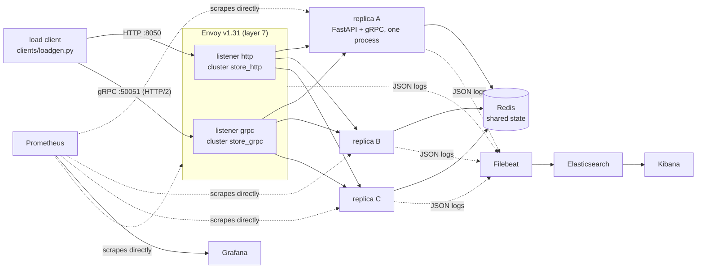

# Assignment 3: Load Balancing — Report

**Enterprise Software Development, Fall 2026**

Three replicas (A, B, C) of the online store run behind Envoy. The A1/A2
stack (Prometheus, Grafana, Elasticsearch/Kibana) shows how Envoy spreads HTTP
requests and gRPC calls.
- **Commands:** setup and every experiment command are in the README.
- **Appendix:** each run's full notes (predictions, timelines, evidence files)
  are in `report-a3-details.md`.
- **Data:** client results are in `evidence/a3/runs/`, screenshots in
  `screenshots/a3/`.

## 1. Architecture and shared state



**The replicas.**
- **Containers:** Compose runs three copies of one image
  (`deploy.replicas: 3`, containers `assignment-1-app-1/2/3`). Each container
  serves HTTP on :8050 and gRPC on :50051 from one process.
- **Replica name:** each replica works out its own name (A/B/C) at startup
  from Docker's reverse DNS. The name appears in every log line, as the
  `replica` label in Prometheus, and in the `X-Replica` response header /
  `x-replica` gRPC metadata.
- **Test traffic:** HTTP uses `GET /products/{id}`, gRPC the unary
  `OrderService/GetProduct`. Both are read-only.

**How Envoy routes.**
- **Listeners:** both are HTTP connection managers (layer 7), not TCP proxies,
  so Envoy picks a replica for every request and every gRPC call.
- **gRPC connections:** the gRPC client keeps a single HTTP/2 connection
  open. Through a TCP proxy, every call on it would go to one replica.
- **Clusters:** `STRICT_DNS` on the container names, HTTP/1.1 upstream for
  `store_http` and HTTP/2 for `store_grpc`.
- **Request ids:** Envoy keeps the caller's `X-Request-ID`, so the proxy's and
  the replica's log lines share it.

**Shared state.** Everything that must agree across replicas lives in one
Redis.

| State | Where | If it were per replica |
|---|---|---|
| Products, carts, orders | Redis hashes/strings; checkout is a `WATCH`/`MULTI` transaction | A cart filled via A would be empty on B; stock could be sold twice |
| Idempotency records (`Idempotency-Key`, A2) | Redis `idem:{scope}:{key}`, claimed with `SET NX EX` | A retried order landing on another replica would create a **second order**; duplicate prevention would only work by luck |
| Rate-limit counters (`POST /orders`, 5 per 10 s per client) | Redis `ratelimit:orders:<ip>`, `SET NX EX` + `INCR` in one `MULTI` | Each replica would count separately, so a client would get about 3× the limit. Moved from process memory to Redis in A3 |
| Client IP for the limit | Last `X-Forwarded-For` entry (Envoy appends the caller) | Behind Envoy every request comes from Envoy's IP, so all clients would share one counter |
| Fault switch (experiments) | Redis `fault:B` / `fault:all` with a TTL | No way to slow down B alone through Envoy |

The shared limit is checked by `test_rate_limit_shared_across_replicas`, and
was checked live through Envoy: 5 orders spread over A, B and C succeed, and
the 6th gets `429` whichever replica answers.

## 2. Load balancer and health-check settings

| Setting | Value |
|---|---|
| Policy (base config) | `ROUND_ROBIN`, `load_balancing_weight: 1` for A, B, C |
| Experiment configs | Generated from the base by `scripts/build_envoy_variants.py`; Compose mounts `envoy/$ENVOY_CONFIG` |
| Active health checks (D3) | HTTP `GET /health`; gRPC `grpc.health.v1.Health/Check` (`service_name: ""`) |
| — interval / timeout | 2 s / 1 s |
| — unhealthy / healthy threshold | 2 failed probes to remove / 2 passed to bring back |
| Connect timeout, retries, circuit breaking, outlier detection | Envoy defaults: 5 s connect timeout; no retry policy; no outlier detection |
| Client | Open loop, no retries, no circuit breaker, 2 s timeout per call |

**Workload for every run.**
`python clients/loadgen.py --interface both --rate 50 --duration 60`
- 50 calls/s HTTP and 50 calls/s gRPC at the same time, for 60 s.
- Call *i* is sent at start + *i*/50 s, whatever happened to earlier calls.
- Latency is measured from when the call was due.

## 3. Metrics and queries

**What Prometheus scrapes.** Prometheus scrapes each replica
(`assignment-1-app-N:8050/metrics`, with a fixed `replica` label) and Envoy
(`envoy:9901/stats/prometheus`) directly, never through Envoy. Through Envoy,
each scrape would land on whichever replica Envoy picked. Scraping is every
2 s.

**The A3 dashboard** (`scripts/build_a3_dashboard.py`):
- **Window:** `$window` = 30 s; a 1 m window never reaches a flat plateau in
  a 60 s run.
- **Graph step:** 2 s.
- **Excluded:** `/metrics`, `/health` and gRPC health checks.

| Panel | Query (HTTP; gRPC uses `grpc_server_handled_total` / `grpc_server_handling_seconds` / `grpc_server_in_flight`) |
|---|---|
| Share over a run | `100 * (sum(increase(http_requests_total{…,replica="B"}[$__range])) or vector(0)) / scalar(sum(increase(http_requests_total{…}[$__range])))` |
| Rate per replica | `sum by (replica) (rate(http_requests_total{job="store",endpoint!~"/metrics\|/health"}[30s]))` |
| Active requests | `sum by (replica) (http_requests_in_flight{…})` (gauge) |
| p50 / p95 | `histogram_quantile(0.95, sum by (le, replica) (rate(http_request_duration_seconds_bucket{…}[30s])))` |
| Errors | `sum by (replica, status) (rate(http_requests_total{…,status=~"4..\|5.."}[30s]))` |
| Envoy | `envoy_cluster_upstream_rq_active`, `envoy_cluster_membership_healthy/_total`, upstream failures (`upstream_cx_connect_fail`, `upstream_cx_connect_timeout`, 5xx, `health_check_failure`) |

**Metric labels.**
- They are replica (3 values), route template, method, status and gRPC
  method/code.
- Request ids and product ids are never labels; they only appear in logs.

**Limits we hit.**
- **Share bars are approximate.** `increase()` extrapolates at the edges of
  the time range, so they are off by about ±1% (34.0/33.3/32.7 for exactly
  1000/1000/1000).
- **Histogram quantiles are approximate.** `histogram_quantile` interpolates
  inside buckets: a 205 ms call shows as p50 175 ms in the 100–250 ms bucket.
- **Replica panels can't see failed calls.** Calls that fail before reaching
  a replica appear only in Envoy's metrics, its access log and the client
  results. That is why the Envoy failures panel was added.

## 4. Baselines

| Run | HTTP A / B / C | gRPC A / B / C | Client p95 HTTP / gRPC | Errors |
|---|---|---|---|---|
| Envoy → A only | 3000 / 0 / 0 | 3000 / 0 / 0 | 9.34 / 7.08 ms | 0 |
| Round robin 1:1:1 | 1000 / 999 / 1001 | 1000 / 1000 / 1000 | 8.51 / 5.88 ms | 0 |

**A only.** A served everything while B and C idled. At 50/s, A was busy
about 3% of the time (1–2 ms per call), so spreading the load barely changed
latency.

**Round robin.** gRPC is exact because the client's single HTTP/2
connection lands on one Envoy worker, which rotates strictly A → B → C. HTTP
is within one call, because the client's ~10 connections land on different
workers, each with its own rotation.

**A host pause.** One first attempt at the baseline lost 8% of its calls to
a ~6 s pause of the whole WSL VM: the load client paused too, while B, C and
Redis were unaffected. It was re-run; the appendix has the evidence.

## 5. Experiments (same workload, base config restored after each)

**D1 — Weighted round robin, A:B:C = 2:1:1.**
- **Predicted:** 50/25/25 and no latency change.
- **Measured:** HTTP 1499/751/750, gRPC 1500/750/750, in the pattern
  A A B C, repeating. Per-replica p50 was 1.3 ms everywhere, as in round
  robin.
- **Why latency didn't change:** a weight gives A twice the calls, not twice
  the capacity. A held about 2× B's in-flight calls (Little's law: 25/s ×
  1.3 ms ≈ 0.03), far from queueing.
- **When it would matter:** if A were really the same size and the load near
  capacity, A would queue first. Use weights only for replicas that really
  are bigger.

**D2 — B 200 ms slower: round robin vs least request.**
- **Round robin:** B kept exactly ⅓ of the calls, held about 3.4 in flight
  (16.7/s × 0.205 s), and every third call took 205 ms. Client p95: 207 /
  205 ms.
- **Least request:** Envoy samples two hosts and takes the one with fewer
  active requests.
  - B almost always has one or two calls open, so it loses nearly every
    comparison.
  - It is still chosen when both samples are B (1/9 ≈ 11%).
  - Measured: B got 14.8% (HTTP) / 14.2% (gRPC), with 1.6–1.7 in flight.
- **Effect on latency:** slow calls fell from 33% to about 14.5%, roughly
  halving the average (≈72 → ≈35 ms). The **p95 stayed at about 205 ms**,
  because more than 5% of calls still hit B.
  - `choice_count: 3` would cut the floor to about 4%.
  - Outlier detection on latency would remove B entirely.
- **No errors** in either run.

**D3 — Stop B during traffic, with health checks.**
- **Timeline:**
  - **Stop:** `docker stop` B at 16:35:45.2.
  - **Ejection:** the health checker removed B at 49.6, after 2 failed
    probes: about 4.4 s, or `unhealthy_threshold × interval`.
  - **Restart:** B was started at 16:36:07.7 and was healthy again at
    11.8 (gRPC) / 12.3 (HTTP).
- **Errors:** before the ejection, B's third of the calls failed: 74 HTTP
  (2.5%) and 68 gRPC (2.3%), which fits 4.2 s × 50/s × ⅓ ≈ 70.
  - First, refused connections gave fast 503 / `UNAVAILABLE`.
  - Then, once the container was gone, connects hung until the client's 2 s
    timeout.
- **After the ejection:** 0 errors, with A and C at 50/50.
- **Recovery:** faster than `healthy_threshold × interval`. Docker DNS had
  dropped the stopped container, so B came back as a new host, and a new
  host is admitted after its first passing probe.
- **Health checks can pass while users fail.** With a 2 s delay on B, B
  stayed healthy while a third of the calls timed out, because the probes
  only check that B is up.

## 6. Summary results

| Run / interface | Policy and fault | Target / actual rps | A / B / C share | Client p95 | Error rate | Explanation |
|---|---|---|---|---|---|---|
| Baseline / HTTP | A only | 50 / 50.02 | 100 / 0 / 0 % | 9.34 ms | 0% | One host in the cluster |
| Baseline / gRPC | A only | 50 / 50.02 | 100 / 0 / 0 % | 7.08 ms | 0% | One host in the cluster |
| RR / HTTP | RR 1:1:1 | 50 / 50.02 | 33.3 / 33.3 / 33.4 % | 8.51 ms | 0% | Per-worker rotation over ~10 connections |
| RR / gRPC | RR 1:1:1 | 50 / 50.02 | 33.3 / 33.3 / 33.3 % | 5.88 ms | 0% | One connection, one worker, strict rotation |
| WRR / HTTP | RR 2:1:1 | 50 / 50.02 | 50.0 / 25.0 / 25.0 % | 8.01 ms | 0% | Weights set the share, not capacity |
| WRR / gRPC | RR 2:1:1 | 50 / 50.02 | 50.0 / 25.0 / 25.0 % | 5.24 ms | 0% | A A B C cycle |
| Slow B / HTTP | RR, B +200 ms | 50 / 50.01 | 33.3 / 33.4 / 33.3 % | 206.99 ms | 0% | RR ignores load; ⅓ of calls slow |
| Slow B / gRPC | RR, B +200 ms | 50 / 50.02 | 33.3 / 33.3 / 33.3 % | 204.56 ms | 0% | Same |
| Slow B / HTTP | Least request, B +200 ms | 50 / 50.02 | 42.8 / 14.8 / 42.3 % | 207.01 ms | 0% | B loses most comparisons; 1/9 floor keeps p95 on B |
| Slow B / gRPC | Least request, B +200 ms | 50 / 50.02 | 41.9 / 14.2 / 43.9 % | 204.51 ms | 0% | Same |
| Stop B / HTTP | RR + health checks, B down 22 s | 50 / 50.02 | 39.8 / 18.1 / 39.6 % | 12.25 ms | 2.47% | Failures only in the 4.4 s before ejection |
| Stop B / gRPC | RR + health checks, B down 22 s | 50 / 50.02 | 39.8 / 18.2 / 39.7 % | 10.5 ms | 2.27% | Same; first passing probe brings B back |

## 7. Checking one distribution against Envoy's access logs

**Round-robin run, three independent sources:**
- the client, from response headers
- Envoy, from its JSON access log, the `replica` field taken from the
  response header
- the replicas, from their own logs

All three agree call for call:

| Source | HTTP A / B / C | gRPC A / B / C |
|---|---|---|
| Load client (`X-Replica` / `x-replica`) | 1000 / 999 / 1001 | 1000 / 1000 / 1000 |
| Envoy access log in Elasticsearch | 1000 / 999 / 1001 | 1000 / 1000 / 1000 |
| Replica logs in Elasticsearch | 1000 / 999 / 1001 | 1000 / 1000 / 1000 |

The other runs were checked the same way. Every run's client counts match
Envoy's log exactly; in D3, Envoy's log has the same 142 failed calls as the
client, all routed to B's address.

## 8. Two proxy/backend log examples

Each pair comes from one Kibana search, `request_id.keyword : "<id>"`, over
the round-robin run. Fields are trimmed.

HTTP, `lg-rr-equal-h-1500`. Envoy chose B; B handled it in 1.5 ms.

```json
{"log_source": "envoy", "request_id": "lg-rr-equal-h-1500", "path": "/products/p7", "upstream_cluster": "store_http",
 "upstream_host": "172.18.0.7:8050", "replica": "B", "response_code": 200, "envoy_duration_ms": 2, "start_time": "2026-11-15T16:09:02.775Z"}
{"log_source": "app", "request_id": "lg-rr-equal-h-1500", "replica": "B", "transport": "http",
 "endpoint": "/products/{product_id}", "status": 200, "duration_ms": 1.53}
```

gRPC, `lg-rr-equal-g-1501`. The next call on the same connection went to C.

```json
{"log_source": "envoy", "request_id": "lg-rr-equal-g-1501", "path": "/store.v1.OrderService/GetProduct", "upstream_cluster": "store_grpc",
 "upstream_host": "172.18.0.9:50051", "replica": "C", "response_code": 200, "grpc_status": "OK", "envoy_duration_ms": 1}
{"log_source": "app", "request_id": "lg-rr-equal-g-1501", "replica": "C", "transport": "grpc",
 "rpc_method": "/store.v1.OrderService/GetProduct", "grpc_code": "OK", "duration_ms": 0.34}
```

## 9. Conclusions

**HTTP: least request (power of two choices) plus active health checks.**
- **When all is well:** with equal, healthy replicas it spreads calls about
  evenly, like round robin (expected from the policy; not run separately).
- **With a slow replica:** it moved more than half of the slow calls away
  automatically (D2), while round robin kept feeding B its full third.
- **What to add:**
  - Health checks remove dead replicas within about `2 × interval` (D3).
  - Outlier detection or `choice_count: 3` would also deal with replicas that
    are up but slow, which health checks miss.
  - A short `connect_timeout` and a `connect-failure` retry for read-only
    routes would hide most D3 errors.

**gRPC: the same policy, on an HTTP/2-aware (layer 7) listener.**
- **Why layer 7 matters most:** one client channel carries every call, so
  only per-call balancing spreads it at all.
- **Results:** round robin gave a perfectly even split and least request
  reacted to B exactly as for HTTP, because Envoy shares per-host active
  counts across workers.
- **Remaining risk:** a gRPC client's reconnect backoff lengthens outages at
  the proxy (below).

**Where I'd choose differently.**
- **Caching:** if each replica kept a local cache of products, I'd use
  consistent hashing (`RING_HASH` on the product id). Each product would
  always hit the same replica and its warm cache, at the cost of an uneven
  split for popular products.
- **Unequal replicas:** if one replica really had twice the CPU, weighted
  round robin (D1) is the simple, predictable choice.

**If Envoy stops.** Envoy is a single point of failure.
- **Measured:** stopping it for 8.2 s during a 10/s run failed **every** call
  in that window (HTTP 99 of 200, gRPC 123 of 200), while Prometheus showed A,
  B and C `up`. The replicas were fine but unreachable.
- **gRPC recovered about 4 s later than HTTP**, because its channel was in
  reconnect backoff when Envoy came back.
- **Improvement:** run two Envoy instances behind one address (a keepalived
  virtual IP, or DNS with two A records plus client retries) so one can fail
  or be upgraded without downtime. Compose's `restart: unless-stopped`
  already restarts a crashed Envoy, but that only shortens the outage; it
  doesn't remove it.

## Reused work and references

- Envoy documentation: load-balancing policies (round robin, least request /
  power of two choices, `choice_count`), active health checking (thresholds,
  `no_traffic_interval`, health-check event log), the HTTP connection manager
  and access-log format strings.
- gRPC health checking protocol (`grpc.health.v1`) and the
  `grpcio-health-checking` package.
- Prometheus documentation on `rate`/`increase` extrapolation and
  `histogram_quantile`.
- Little's law (L = λW) for checking in-flight counts.
- The A1/A2 project (FastAPI app, gRPC service, metrics, ELK pipeline) is
  reused as the base. A2's references (RFC 9457, Idempotency-Key draft, gRPC
  status codes) still apply.
- Developed with help from an AI coding assistant (Claude Code), reviewed and run by me.
