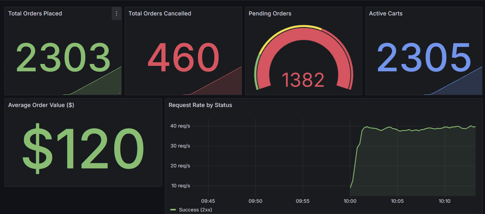
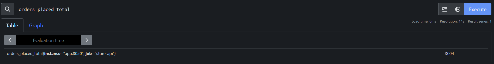
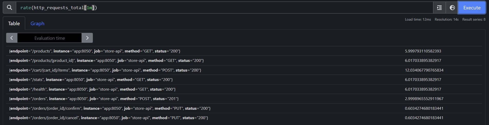
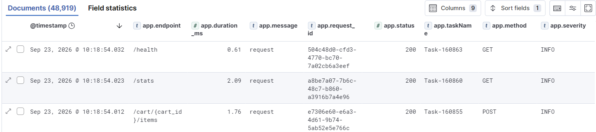
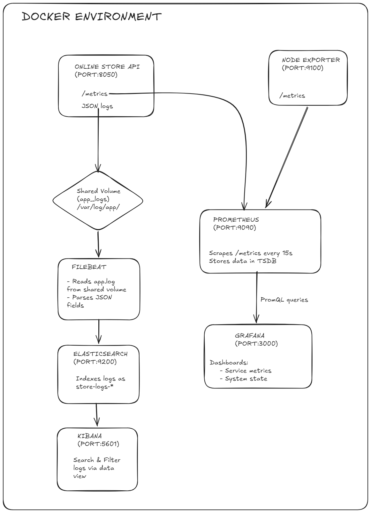

# Assignment 1: Observability — Report

**Enterprise Software Development, Fall 2026**

---

## Part A: Project

### Problem

Small online retailers need a lightweight order management system to track products, shopping carts, and order fulfillment without the overhead of large e-commerce platforms.

### Intended Users

Store operators who manage product listings and fulfill orders, and customers who browse products, add items to carts, and place orders.

### Solution

An **Online Store REST API** built with **FastAPI** (Python). It provides:

- **Product catalog** — 8 pre-seeded products across electronics, stationery, and furniture categories
- **Shopping cart** — add/remove items, view totals per cart
- **Order management** — place orders from a cart, then move through a fulfillment workflow:

```
PENDING → CONFIRMED → SHIPPED → DELIVERED
   └────────┴──────────┴──────→ CANCELLED
```

- **Stock management** — placing an order deducts stock; cancelling restores it
- **Stats endpoint** — order counts by status, total revenue, active carts

Data is stored in memory (resets on restart), which is sufficient since the focus is observability, not persistence.

### How to Try It

```bash
docker compose up --build
```

- API: http://localhost:8050
- Interactive docs: http://localhost:8050/docs

| Method | Path | Description |
|--------|------|-------------|
| GET | `/products` | List products (optional `?category=electronics`) |
| GET | `/products/{id}` | Get a product |
| POST | `/cart/{cart_id}/items` | Add item to cart |
| GET | `/cart/{cart_id}` | View cart |
| DELETE | `/cart/{cart_id}/items/{product_id}` | Remove item |
| POST | `/orders?cart_id={cart_id}` | Place order |
| GET | `/orders` | List orders |
| PUT | `/orders/{id}/confirm` | Confirm order |
| PUT | `/orders/{id}/ship` | Ship order |
| PUT | `/orders/{id}/deliver` | Deliver order |
| PUT | `/orders/{id}/cancel` | Cancel order |
| GET | `/stats` | Business stats |
| GET | `/health` | Health check |
| GET | `/metrics` | Prometheus metrics |

---

## Part B: Metrics

### Setup

- **Prometheus** (v2.54.0) scrapes the app's `/metrics` endpoint and Node Exporter every 15 seconds
- **Grafana** (v11.2.0) queries Prometheus and displays dashboards
- **Node Exporter** (v1.8.2) exposes host-level CPU, memory, disk, and network metrics
- The app uses `prometheus_client` (Python) to define and expose metrics

The app exposes a `/metrics` endpoint that returns all registered metrics in Prometheus text format via `generate_latest()`.

### Metric Table

| Metric Name | Type | Purpose | Unit | Labels | Where Recorded | Grafana Query |
|-------------|------|---------|------|--------|----------------|---------------|
| `orders_placed_total` | Counter | Total orders placed | count | — | `place_order()` in `main.py:192` | `orders_placed_total` |
| `orders_cancelled_total` | Counter | Total orders cancelled | count | — | `cancel_order()` in `main.py:330` | `orders_cancelled_total` |
| `http_requests_total` | Counter | Total HTTP requests by method, endpoint, status | count | `method`, `endpoint`, `status` | Middleware in `main.py:66-68` | `sum(rate(http_requests_total{status=~"2.."}[1m]))` for success rate |
| `orders_pending` | Gauge | Orders currently in PENDING state | count | — | `place_order()` inc, `confirm_order()` dec, `cancel_order()` dec | `orders_pending` |
| `active_carts` | Gauge | Shopping carts with items | count | — | `add_to_cart()`, `remove_from_cart()`, `place_order()` | `active_carts` |
| `http_request_duration_seconds` | Histogram | Request latency distribution | seconds | `method`, `endpoint` | Middleware in `main.py:69-71` | `histogram_quantile(0.95, sum by (le) (rate(http_request_duration_seconds_bucket[5m])))` for p95 |
| `order_value_dollars` | Summary | Order value tracking (sum and count for average) | dollars | — | `place_order()` in `main.py:194` | `order_value_dollars_sum / order_value_dollars_count` for average |

### Dashboard Panels

The Grafana dashboard (`grafana/dashboard.json`) includes:

1. **Total Orders Placed** (stat) — shows the cumulative counter value
2. **Total Orders Cancelled** (stat) — cumulative cancelled orders
3. **Pending Orders** (gauge visualization) — current pending count with green/yellow/red thresholds
4. **Active Carts** (stat) — current number of non-empty carts
5. **Average Order Value** (stat) — `order_value_dollars_sum / order_value_dollars_count`, displayed in USD
6. **Request Rate by Status** (timeseries) — three lines grouping HTTP responses into 2xx (success), 4xx (client error), 5xx (server error) using `sum(rate(http_requests_total{status=~"2.."}[1m]))`
7. **p95/p99 Request Latency** (timeseries) — `histogram_quantile(0.95, sum by (le) (rate(http_request_duration_seconds_bucket[5m])))` shows that ~95% of requests complete within the displayed time; the `[5m]` window means percentiles are computed over a 5-minute rolling window
8. **Request Rate by Endpoint** (timeseries, bar style) — shows which endpoints receive the most traffic




### Endpoint Path Normalization

The middleware matches each request against FastAPI's route definitions to use the template path (e.g., `/orders/{order_id}/confirm`) instead of the raw URL. This prevents cardinality explosion from dynamic path segments. See `main.py:57-63`.

### Node Exporter

Node Exporter runs as a Docker container with access to the host's `/proc`, `/sys`, and `/` filesystems. It exposes system metrics at port 9100. Prometheus scrapes it alongside the app. The machine being measured is the Docker host (WSL Ubuntu instance).

A pre-built community dashboard (Grafana ID 1860) displays CPU usage, memory usage, disk I/O, network traffic, and filesystem utilization.


### Self-Explored Metric

The **Request Rate by Status** panel groups HTTP responses into success (2xx) and error (4xx/5xx) categories using regex label matching. This goes beyond individual status codes to give an at-a-glance view of system health. The query `sum(rate(http_requests_total{status=~"4.."}[1m]))` aggregates all client errors regardless of specific code.

### Prometheus Queries





---

## Part C: Logs

### What We Log and Why

| Event | Severity | Where in Code | Fields | Why |
|-------|----------|---------------|--------|-----|
| Every HTTP request | INFO | Middleware `main.py:76-85` | request_id, method, endpoint, status, duration_ms | Trace any request, spot slow or failed responses |
| Order placed | INFO | `place_order()` `main.py:197-204` | request_id, order_id, total | Track business activity, revenue |
| Order cancelled | INFO | `cancel_order()` `main.py:332-338` | request_id, order_id | Track cancellation rate |
| Item added to cart | INFO | `add_to_cart()` `main.py:155-162` | request_id, cart_id, product_id | Track shopping behavior |
| Product not found | WARNING | `get_product()`, `add_to_cart()` | request_id, product_id | Detect bad links or missing inventory |
| Order not found | WARNING | `get_order()`, `confirm_order()`, etc. | request_id, order_id | Detect invalid order references |
| Status update failed | WARNING | `confirm_order()`, `ship_order()`, etc. | request_id, order_id | Detect invalid state transitions |
| Fault injected | WARNING | Middleware `main.py:46-49` | request_id, delay_ms | Track when experiment fault fires |

We never log secrets or personal data. Request IDs are UUIDs generated per request.

### Log Format

The app uses `python-json-logger` (`app/logger.py`) to output structured JSON to stdout:

```json
{
  "message": "request",
  "timestamp": "2026-09-20 11:14:22,771",
  "severity": "INFO",
  "service": "store",
  "request_id": "abf95ee2-0a82-430f-9287-de1f45688cc2",
  "method": "GET",
  "endpoint": "/products",
  "status": 200,
  "duration_ms": 1.42
}
```

### How Filebeat Collects and Parses Logs

Pipeline: **App writes JSON to log file → Filebeat reads and parses → Elasticsearch stores → Kibana searches**

The app writes structured JSON logs to both stdout and a file (`/var/log/app/app.log`) via a shared Docker volume (`app_logs`). Filebeat reads from this shared volume, which means it works reliably regardless of container ID changes.

Filebeat configuration (`filebeat/filebeat.yml`):

1. **Log input** reads from `/var/log/app/app.log` (shared volume)
2. **`json.keys_under_root`** parses each line as JSON and promotes fields to the document root
3. **`drop_fields`** processor removes Filebeat metadata (agent, ecs, host, etc.) to keep documents clean
4. An **`es-init`** sidecar container creates a plain index template on startup (without the `data_stream` block that ES 8.x adds by default), ensuring logs are stored as regular indices that Kibana can easily query

Stored fields in Elasticsearch:
- `@timestamp` — when Filebeat read the log
- `timestamp` — when the app wrote the log
- `severity` — INFO, WARNING, etc.
- `service` — "store"
- `message` — event name (e.g., "request", "order_placed")
- `request_id` — UUID for tracing
- `method`, `endpoint`, `status`, `duration_ms` — HTTP details
- `order_id`, `cart_id`, `product_id` — business context

### Where Logs Live and Retention

| Location | What | Survives Restarts? |
|----------|------|--------------------|
| Shared volume (`app_logs`) at `/var/log/app/app.log` | App's structured JSON logs | Yes (Docker volume) |
| Filebeat registry (`filebeat_data` volume) | Read offsets so Filebeat doesn't re-read | Yes (Docker volume) |
| Elasticsearch (`es_data` volume) | Indexed, searchable log documents | Yes (Docker volume) |

Old logs: Elasticsearch indices can be managed with ILM (Index Lifecycle Management) policies, but we have not configured automatic deletion for this project. Running `docker compose down -v` removes all volumes.

### Searching in Kibana

Data view: `store-logs-*` with timestamp field `@timestamp`.




Example searches in Kibana Discover:
- `message: "order_placed"` — find all order placements
- `severity: "WARNING"` — find all warnings
- `request_id: "abf95ee2-0a82-430f-9287-de1f45688cc2"` — trace a single request
- `status: 404` — find all not-found responses
- `duration_ms > 100` — find slow requests

### Example: Original Log → Stored Fields → Search

**Original log** (app writes to `/var/log/app/app.log`):
```json
{"message": "order_placed", "timestamp": "2026-09-20 11:14:23,001", "severity": "INFO", "service": "store", "request_id": "c3d4e5f6-...", "order_id": "a1b2c3d4-...", "total": 119.98}
```

**Stored in Elasticsearch** (after Filebeat processing):
```json
{
  "@timestamp": "2026-09-20T11:14:23.001Z",
  "message": "order_placed",
  "timestamp": "2026-09-20 11:14:23,001",
  "severity": "INFO",
  "service": "store",
  "request_id": "c3d4e5f6-...",
  "order_id": "a1b2c3d4-...",
  "total": 119.98
}
```

**Kibana search**: `message: "order_placed" AND total > 100`

---

## Part D: System Design

### 1. Architecture Diagram



**Component roles:**

| Component | Role | Data Storage |
|-----------|------|-------------|
| **Online Store API** | Serves HTTP requests, exposes /metrics, writes JSON logs to shared volume | In-memory (no persistence) |
| **Prometheus** | Scrapes metrics, stores time series | `prometheus_data` Docker volume (TSDB) |
| **Grafana** | Visualizes metrics via dashboards | `grafana_data` Docker volume (SQLite) |
| **Node Exporter** | Exposes host system metrics | None (stateless) |
| **Filebeat** | Reads app logs from shared volume, parses JSON, forwards to ES | `filebeat_data` Docker volume (registry) |
| **Elasticsearch** | Indexes and stores log documents | `es_data` Docker volume |
| **Kibana** | Provides log search and visualization UI | Uses Elasticsearch as backend |

**Why this design:**
- Metrics and logs are separate pipelines — metrics for real-time alerting and dashboards, logs for detailed debugging and auditing
- Prometheus pull model means the app doesn't need to know about Prometheus — it just exposes /metrics
- Filebeat reads Docker's native log files, requiring no changes to the app's logging output
- All data is stored in Docker volumes for persistence across container restarts

**What happens if a component stops:**

| Component Down | Effect |
|---------------|--------|
| **App** | No requests served; metrics and logs stop. Prometheus shows target as DOWN. Existing data in Prometheus/ES remains. |
| **Prometheus** | Metrics stop being collected. Grafana shows "no data". App continues working normally. |
| **Grafana** | Dashboards unavailable. No impact on app or data collection. |
| **Node Exporter** | System metrics stop. App and business metrics unaffected. |
| **Filebeat** | Logs stop flowing to ES. Container log files continue growing on disk. When Filebeat restarts, it resumes from its saved offset. |
| **Elasticsearch** | Filebeat queues logs and retries. Kibana shows errors. No log search until ES recovers. |
| **Kibana** | Log search UI unavailable. Logs continue to be collected and stored. |

### 2. Follow a Metric and a Log

#### Following a Metric: `orders_placed_total`

**Step 1 — Code updates it** (`main.py:192`):
```python
orders_placed_total.inc()
```
When `place_order()` succeeds, the counter increments from its current value (e.g., 5) to 6. The `prometheus_client` library holds this value in memory.

**Step 2 — Prometheus collects it:**
Every 15 seconds, Prometheus sends a GET request to `http://app:8050/metrics`. The response includes:
```
# HELP orders_placed_total Total number of orders placed
# TYPE orders_placed_total counter
orders_placed_total 6.0
```
Prometheus parses this and stores the sample `(orders_placed_total, timestamp, 6.0)` in its time-series database.

**Step 3 — Grafana queries and displays it:**
The "Total Orders Placed" panel runs the PromQL query `orders_placed_total`. Prometheus returns the latest value (6). Grafana renders it as a stat panel showing "6". For the timeseries view, Grafana requests a range query and Prometheus returns all samples in the time window, which Grafana plots as a line.

#### Following a Log: `order_placed`

**Step 1 — Code writes it** (`main.py:197-204`):
```python
logger.info("order_placed", extra={
    "request_id": request.state.request_id,
    "order_id": order.id,
    "total": order.total
})
```
`python-json-logger` formats this as a JSON string and writes it to both stdout and `/var/log/app/app.log` (a shared Docker volume).

**Step 2 — Filebeat reads and parses it:**
Filebeat's log input reads from `/var/log/app/app.log` (mounted as a shared volume). The `json.keys_under_root` setting parses each JSON line and promotes the fields to the document root. The `drop_fields` processor then removes Filebeat's internal metadata (agent, ecs, host, etc.), leaving only the app's fields.

**Step 3 — Elasticsearch stores it:**
Filebeat sends the document to Elasticsearch via HTTP POST to the `store-logs-2026.09.20` index. Elasticsearch indexes all fields, making them searchable.

**Step 4 — Kibana finds it:**
In Discover with the `store-logs-*` data view, searching `message: "order_placed"` queries Elasticsearch, which returns matching documents. Each result shows the full document with all fields expandable.

---

## Part E: Experiments

### 1. Reproduce a Problem: Injected Latency and Errors

**Setup:** The middleware checks the `FAULT_INJECTION` environment variable. When `true`:
- Every 5th request gets a **500ms delay** (`time.sleep(0.5)`) before processing
- Every 7th request returns an **HTTP 500 error** immediately
- Every 35th request gets both (delay + error)

**Procedure:**

1. **Normal behavior** — run with `FAULT_INJECTION=false`:
   ```bash
   docker compose up --build
   bash test_traffic.sh
   ```
   Observe in Grafana: p95 latency is ~1-5ms, request rate is steady, all requests return 2xx.

2. **Predict changes:**
   - p95 latency will jump to ~500ms (since 20% of requests are delayed)
   - ~14% of requests will return HTTP 500 errors
   - Logs will show `fault_injected` warnings with `fault: "latency"` or `fault: "error"`
   - The "Request Rate by Status" panel will show a 5xx line appearing

3. **Inject the fault** — set `FAULT_INJECTION=true` in `docker-compose.yml` and rebuild:
   ```bash
   docker compose up --build
   bash test_traffic.sh
   ```

4. **Results:**


   The p95 latency spikes to ~500ms, and the Request Rate by Status panel shows 5xx errors alongside the 2xx successes. In Kibana, searching `message: "fault_injected"` shows both latency and error faults with their details.

5. **Effect on users:** 20% of requests are slow (500ms+ instead of <5ms) and ~14% fail entirely with a 500 error. Users experience intermittent slowness and failures.

6. **Remove the fault** — set `FAULT_INJECTION=false`, rebuild, run traffic again. p95 latency returns to normal and 5xx errors disappear.

**Key queries:**
- Grafana: `histogram_quantile(0.95, sum by (le) (rate(http_request_duration_seconds_bucket[5m])))`
- Grafana: `sum by (status) (rate(http_requests_total[1m]))` — shows 5xx line
- Kibana: `message: "fault_injected"`

### 2. Cardinality Explosion

**What it is:** Cardinality explosion happens when a metric label has many unique values (like request IDs), creating a separate time series for each. This wastes Prometheus memory and slows queries.

**Procedure:**

The app has a built-in `POST /demo/cardinality` endpoint that demonstrates this. It accepts `mode` (good/bad) and `count` parameters.

1. **Good practice (1 time series)** — call the endpoint with `mode=good`:
   ```
   POST /demo/cardinality?mode=good&count=100
   ```
   This increments `demo_requests_total_good_total` — a counter with no per-request labels. All 100 increments go to a single time series.

   In Prometheus, query: `count(demo_requests_total_good_total)` → returns **1**.

   

2. **Bad practice (100 time series)** — call the endpoint with `mode=bad`:
   ```
   POST /demo/cardinality?mode=bad&count=100
   ```
   This increments `demo_requests_total_bad_total` — a counter with a unique `request_id` label per call. Each call creates a new time series.

   In Prometheus, query: `count(demo_requests_total_bad_total)` → returns **100**.

   

3. **Cost at scale:** If this were a production system handling 1 million requests/day, the `request_id` label would create 1 million time series per day. Each series consumes ~1-2 KB of memory in Prometheus. That's ~1-2 GB of RAM just for one metric. Queries like `rate(demo_requests_total_bad_total[5m])` would need to scan all 1 million series. This is why request IDs belong in **logs** (Elasticsearch handles high-cardinality text fields efficiently) and not in **metric labels**.

---

## Appendix: Running the Project

### Start
```bash
docker compose up --build
```

### Services
| Service | URL |
|---------|-----|
| App | http://localhost:8050 |
| App Docs | http://localhost:8050/docs |
| Prometheus | http://localhost:9090 |
| Grafana | http://localhost:3000 (admin/admin) |
| Kibana | http://localhost:5601 |
| Node Exporter | http://localhost:9100 |

### Setup after fresh start
1. **Grafana**: Add Prometheus datasource (`http://prometheus:9090`), import `grafana/dashboard.json`, import Node Exporter dashboard (ID 1860)
2. **Kibana**: Create data view `store-logs-*` with `@timestamp`

### Simulate traffic
```bash
bash test_traffic.sh
```

### Fault injection experiment
Set `FAULT_INJECTION=true` in `docker-compose.yml`, then `docker compose up --build`.

### Clean up
```bash
docker compose down        # stop containers
docker compose down -v     # stop and remove all data
```
